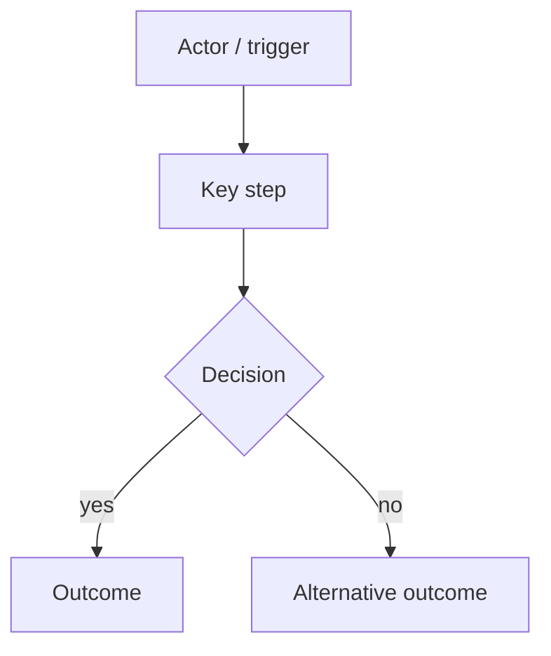

This skill takes the current conversation context and codebase understanding and produces a short spec (you may know this document as a PRD).
Do NOT interview the user — just synthesize what you already know.

The spec has two readers: the user, who reads the TL;DR, and the implementing agent, who reads everything. Keep every fact the agent needs
to build and test the feature; cut everything else.

## Before you start

This skill expects to run after a `grill-me` session (or an equivalent discussion that settled the feature's requirements). If this
conversation has no such discussion, stop: write nothing and tell the user to run `/grill-me` first.

## Process

1. Check what this conversation has already read:
   - **No code read yet** (e.g. the grilling stayed at requirements level): get a shallow overview first (README, CLAUDE.md, top-level structure) to find where the
     feature lives, then explore that area in depth — enough to name the modules, seams and interfaces the spec will reference. Do not
     read the whole repo.
   - **Code already read:** do NOT re-explore. Rely on what's in context.

   Either way, then look up anything the spec needs that still hasn't been covered, typically:
   - the domain glossary and any ADRs in the area you're touching (if not already read)
   - prior-art tests near the proposed seam(s)
   - the code at a proposed seam, if it hasn't been opened

   Use the glossary vocabulary throughout the spec. Reference glossary terms and ADRs by name — do not restate them.

2. Sketch out the seams at which you're going to test the feature. Existing seams should be preferred to new ones. Use the highest seam
   possible. If new seams are needed, propose them at the highest point you can. The fewer seams across the codebase, the better - the ideal
   number is one.

   Check with the user that these seams match their expectations.

3. Write the spec using the template below. The Overview Diagram is mandatory: only omit it when the user has explicitly said to. If you
   believe the idea genuinely can't be expressed as a diagram, ask the user before omitting it — never drop it silently.

4. Edit pass before publishing:
   - Confirm the Overview Diagram is present (unless the user explicitly asked to omit it) and shows the premise, not implementation detail.
   - Delete any line that wouldn't change what gets built or how it's tested.
   - Delete anything stated in another section — say it once, in the most specific place.
   - Delete generic advice (e.g. what makes a good test — the `tdd` skill covers that).
   - Check every section is within its length budget.

5. Publish to `.specs/` in the current repo.

## Formatting

Hard-wrap all prose (paragraphs and list items) at ~140 columns — break lines manually with real newlines rather than emitting single long
lines. Headings, code fences, and inline code spans are exempt.

Prefer one-line bullets over paragraphs. Omit any optional section that would be empty — never write "N/A" or "None".

<spec-template>

# <Feature name>

## TL;DR

5–8 lines max. A human should be able to stop reading here and know what's happening:

- **Problem:** one line, from the user's perspective
- **Approach:** one or two lines, from the user's perspective
- **Test seam(s):** where the feature is tested
- **Out of scope:** the most important exclusion(s)

## Overview Diagram

Mandatory. A small Mermaid `flowchart` (roughly 5–15 nodes) showing the general premise of the idea — main actors, steps and outcomes,
not implementation detail. Use the same vocabulary as the rest of the spec.

## Acceptance Criteria

A numbered list of testable statements describing externally observable behavior, grouped under short subheadings by area if there are
more than ~8. Each criterion is one line, specific enough that a reviewer can say pass/fail.

<example>
### Balances
1. Each account shows its current balance, refreshed on screen open
2. Overdrawn balances render negative and in the warning style
</example>

Cover every behavior the feature must have, including error and edge cases — but one criterion per distinct behavior. Do not write
variations of the same criterion.

## Implementation Decisions

One-line bullets for decisions actually made. Only include categories that apply:

- Modules built/modified and their changed interfaces
- Architectural decisions (cite ADRs by name rather than restating them)
- Schema changes and API contracts
- Technical clarifications from the developer

Do NOT include specific file paths or code snippets. They may end up being outdated very quickly.

Exception: if a prototype produced a snippet that encodes a decision more precisely than prose can (state machine, reducer, schema, type
shape), inline it within the relevant decision and note briefly that it came from a prototype. Trim to the decision-rich parts only.

## Testing

Bullets only, no general testing advice:

- Seam(s) under test and which modules they exercise
- Prior art: similar tests in the codebase to copy the style of

## Out of Scope

Bullets. Everything deliberately excluded, including what the TL;DR didn't have room for.

## Open Questions (optional)

Only unresolved items the implementer must know about. Omit if none.

</spec-template>
